<div align="center">

<a href="https://buildwithtabs.com">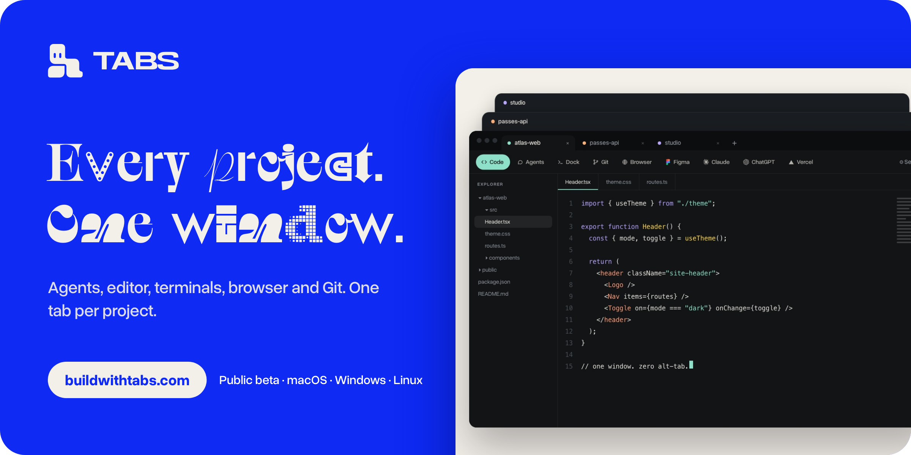</a>

<br />

**[Download](https://buildwithtabs.com/downloads)** &nbsp;·&nbsp; [Watch the film](docs/readme/tabs-launch.mp4) &nbsp;·&nbsp; [Build it yourself](#build-it-yourself) &nbsp;·&nbsp; [Docs](tabs-app/docs/README.md) &nbsp;·&nbsp; [What’s new](CHANGELOG.md) &nbsp;·&nbsp; [Shoutouts](#acknowledgments--shoutouts)

</div>

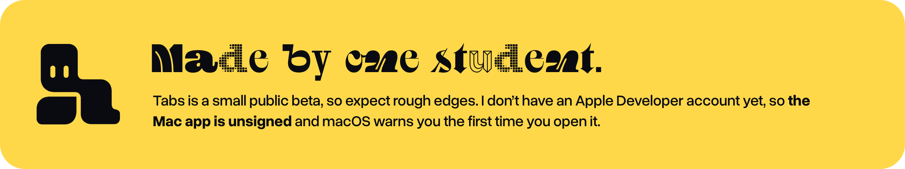

<div align="center">

On a Mac? &nbsp;[Allow the app in two clicks](#if-macos-blocks-the-app) &nbsp;·&nbsp; [Build it yourself](#build-it-yourself)

</div>

> [!NOTE]
> **Built on open source, not from scratch.** Tabs started as a fork of [T3 Code](https://github.com/pingdotgg/t3code) by T3 Tools, and its editor is Microsoft's [Code OSS](https://github.com/microsoft/vscode). The project tabs, the one-window workspace and the desktop app are built on top of that. [Shoutouts below](#acknowledgments--shoutouts).

## Nine windows. One job.

Editor, terminal, browser, agents, Git, design files. Tabs puts them in one window.

<div align="center">
<a href="docs/readme/tabs-launch.mp4">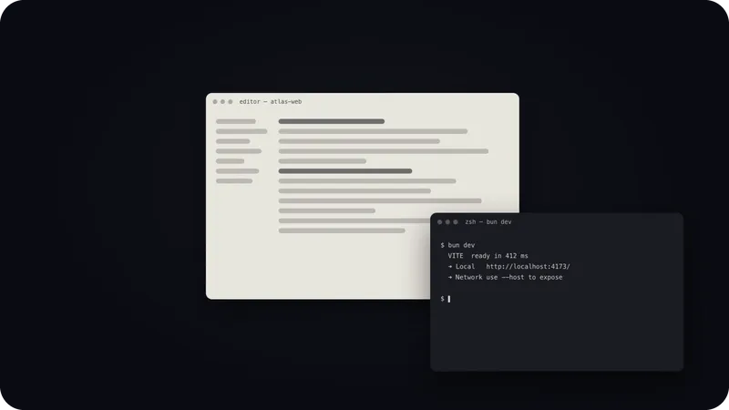</a>
</div>

## One tab per project

Switch projects like browser tabs. Each one keeps its own files, agents, terminals and toolbar.

<div align="center">
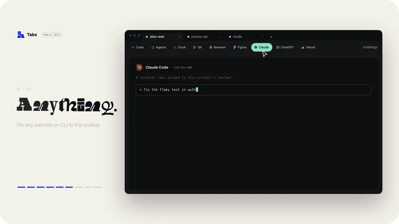
</div>

## What’s inside

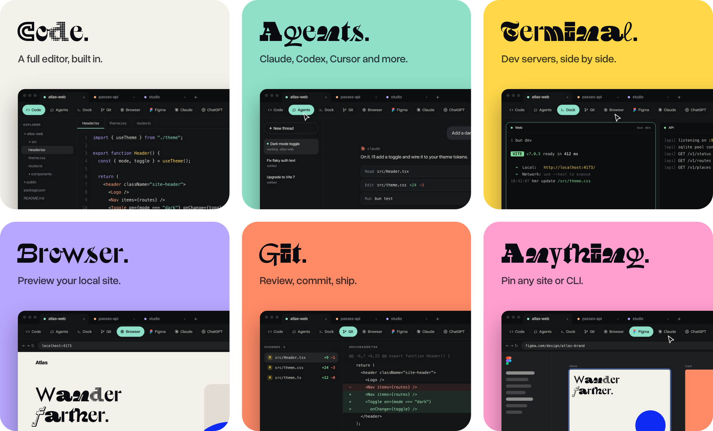

Press **⌘ ⌥ K** (or **Ctrl Alt K**) for Quick Actions: jump to a tool, or open a throwaway browser or terminal.

<details>
<summary>See the real app</summary>

<br />

<picture>
  <source media="(prefers-color-scheme: dark)" srcset="docs/readme/app-dark.png" />
  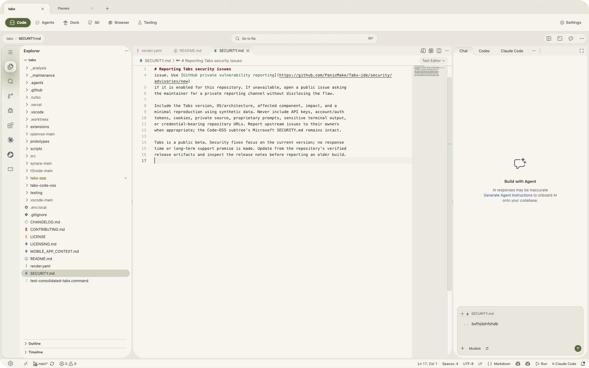
</picture>

</details>

## Meet Notch, your AI teammate

Notch is a long-lived AI teammate that lives in Tabs. You chat with it, and it hands real code work to normal Tabs threads, keeps track of them and tells you when it needs you. It is off by default.

- **Turn it on:** **Settings → Labs → Teammates: Notch, your AI teammate**. The first time you enable it, a teammate named Notch is created. Manage teammates in **Settings → Teammates**.
- **Name and multiple teammates:** rename Notch whenever you like, or add more teammates. Each one has its own name, personality, memory, model, colour finish and schedule.
- **Home folder:** every teammate has a folder with `SOUL.md` (who it is and how it works) and `MEMORY.md` (what it remembers about you and your projects). You can read and edit both, and you can forget individual memories in Settings.
- **Items and workers:** when you ask for code work, the teammate starts a worker, which is a normal Tabs thread in its own worktree, and tracks it as an item: to do, working, needs you, done or dropped. When a worker finishes, the result is posted back to the teammate’s chat.
- **Up Next:** turn on the look-around for a teammate and it checks in on a schedule (every 4 hours, every 2 hours, twice a day or mornings), read-only, and posts suggestions. Start one and it becomes a worker. Dismiss one and it is not suggested again. **Look around now** runs it on demand.
- **Moods:** the teammate is drawn as the Tabs mascot in a corner of the window. It looks idle, thinking, working, waiting for you, happy, upset or asleep (paused) to match what it is doing. You can hide the corner mascot.
- **Privacy:** everything stays on your machine. Teammates use your own agent subscriptions, with no Tabs account, cloud service or sharing.

## Also new

<details>
<summary>Search past agent sessions</summary>

<br />

Search what you and your agents did before, across Claude Code, Codex, Gemini and OpenCode history on this machine. Tabs builds a local full-text index in the background the first time you open it, and nothing is uploaded.

- **Turn it on:** **Settings → Labs → Session search**.
- **Where:** the Command Palette (**Search past agent sessions**) or Quick Actions.
- **Use it:** filter by agent, project folder or date range. **Enter** resumes the session in a terminal. **Cmd/Ctrl Enter** copies the resume command instead. If an agent has no resume command, Tabs copies the transcript path.

</details>

<details>
<summary>Workspace cleanup, with evidence</summary>

<br />

Find old agent worktrees that are safe to remove. For each worktree Tabs shows its evidence (last activity, size on disk, uncommitted files, unpushed commits and pull request state) and a verdict, then removes only what you select, after a confirmation.

- **Where:** **Settings → Workspace Maintenance**, in the workspace cleanup section.
- **Rules:** remove when the branch is merged, the pull request is merged or closed, or there has been no activity for a number of days (14 by default). Worktrees with uncommitted changes or unpushed commits are kept unless you relax those rules.
- Main worktrees, project roots, locked worktrees and any worktree whose evidence cannot be read are never offered for removal.

</details>

<details>
<summary>Terminal quick commands</summary>

<br />

Save the commands you type often and run them in the active terminal in one step.

- **Where to save them:** **Settings → Terminal Commands**. Each command can run in a specific project, with or without pressing Enter at the end. You can search, reorder and edit them.
- **Where to run them:** the terminal toolbar, the Command Palette or Quick Actions. The command is typed into the terminal you used last, and Tabs asks you to open a terminal if none is open.

</details>

<details>
<summary>Computer use for agents</summary>

<br />

Let an agent read and control native desktop apps through accessibility: snapshots of the UI, clicks, typing, keys, scrolling, drags and window screenshots. It is off by default.

- **Turn it on:** **Settings → Labs → Computer use**. **Check permissions** shows what is still missing.
- **macOS:** allow Tabs under **System Settings → Privacy & Security → Accessibility**, and **Screen Recording** for screenshots.
- **Windows:** needs PowerShell.
- **Linux:** needs `python3` with AT-SPI, and `xdotool`.
- **Safety:** only full-access threads can use it. Agents cannot type into password fields, and quit, log-out and lock shortcuts are blocked.

</details>

<br />

<a name="get-tabs"></a>

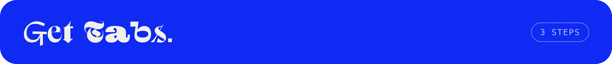

<a href="https://buildwithtabs.com/downloads">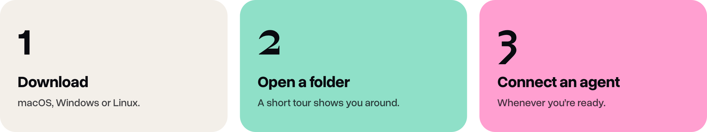</a>

<div align="center">

**[Download Tabs →](https://buildwithtabs.com/downloads)**

</div>

Connect an agent later in **Settings → Providers**.

<a name="if-macos-blocks-the-app"></a>

<details>
<summary>If macOS blocks the app</summary>

<br />

1. Try to open Tabs once and dismiss the warning.
2. Open **System Settings → Privacy & Security** and choose **Open Anyway**.

[Apple’s guide](https://support.apple.com/102445) covers the same steps.

</details>

<details>
<summary>Which download do I need?</summary>

<br />

- **Mac:** open **Apple menu → About This Mac** to see whether you have Apple Silicon or Intel.
- **Windows:** run the `.exe` installer.
- **Linux:** use the `.AppImage` and allow it to run as a program if asked.

</details>

<a name="build-from-source"></a>
<a name="quick-start"></a>

<br />

<a name="build-it-yourself"></a>

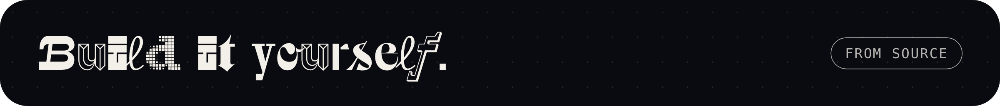

Two folders matter. You compile one, and you run the other.

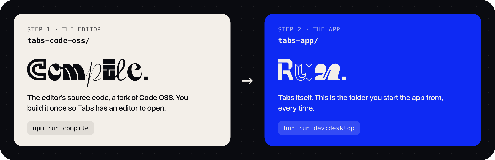

**1 · Get the code**

```sh
git clone https://github.com/PanicMako/Tabs-ide.git
cd Tabs-ide
```

**2 · Compile the editor** (once, and it takes a while)

```sh
cd tabs-code-oss
npm install
npm run compile
node build/next/index.ts bundle --nls
```

**3 · Run Tabs** (every time)

```sh
cd ../tabs-app
bun install
bun run dev:desktop
```

<details>
<summary>What you need installed</summary>

<br />

- [Node.js](https://nodejs.org) and npm, at the version in [`tabs-code-oss/.nvmrc`](tabs-code-oss/.nvmrc)
- [Bun](https://bun.sh) 1.3.9 or newer in the 1.3 line
- Python 3 and a C/C++ toolchain for your OS
- Git

Stuck, or want to work on the code? See the [developer guide](tabs-app/README.md) and the [docs index](tabs-app/docs/README.md).

</details>

<a name="supported-providers"></a>

<br />

<a name="bring-your-own-agents"></a>

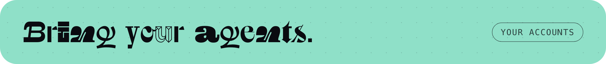

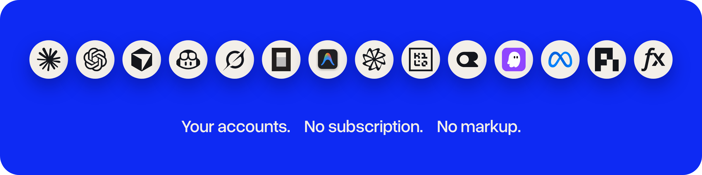

<details>
<summary>Supported agents and how to connect each</summary>

<br />

| Agent              | How to connect                                                                             |
| ------------------ | ------------------------------------------------------------------------------------------ |
| OpenAI Codex       | Install the [Codex CLI](https://developers.openai.com/codex/cli) and run `codex login`.    |
| Anthropic Claude   | Install [Claude Code](https://claude.com/product/claude-code) and run `claude auth login`. |
| Cursor             | Install the [Cursor CLI](https://cursor.com/cli) and run `agent login`.                    |
| GitHub Copilot     | Sign in with GitHub or configure a Copilot token.                                          |
| xAI Grok Build     | Install the [Grok Build CLI](https://x.ai/cli) and run `grok login`.                       |
| OpenCode           | Install [OpenCode](https://opencode.ai) and run `opencode auth login`.                     |
| Google Antigravity | In Providers, enable Antigravity, choose **Install Antigravity**, and sign in with Google. |
| Google Gemini      | Add an API key in Providers or set `GEMINI_API_KEY`.                                       |
| Droid              | Install the Droid CLI or set the path to an existing installation in Providers.            |
| Kilo               | Install the Kilo runtime or configure its path in Providers.                               |
| OpenRouter         | Add an OpenRouter API key in Providers.                                                    |
| Kiro               | Install the Kiro CLI and run `kiro-cli login`, then add Kiro in Providers.                 |
| Muse Code          | Install Muse Code and run `muse login`.                                                    |
| Pi                 | Run `npm install -g @earendil-works/pi-coding-agent`, then `/login` inside `pi`.           |
| fx                 | Install fx and run `fx login`, then add fx in Providers.                                   |

Your provider’s own plan and usage charges apply.

</details>

<br />

<a name="good-to-know"></a>

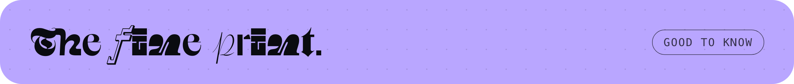

<details>
<summary>Privacy</summary>

<br />

Tabs does not collect your code, chats, or provider keys. Requests go to the provider you configure. Packaged releases send an anonymous daily activity ping with installation and version metadata. Set `TABS_TELEMETRY_ENABLED=false` before starting Tabs to turn it off. [Read the privacy details](tabs-app/docs/privacy.md).

</details>

<details>
<summary>Bugs, contributing and releases</summary>

<br />

- [Report a bug](https://github.com/PanicMako/Tabs-ide/issues/new?template=bug_report.yml)
- Read the [docs](tabs-app/docs/README.md), [contribute](CONTRIBUTING.md) or read the [security policy](SECURITY.md)
- [Releases](https://github.com/PanicMako/Tabs-ide/releases) and [release history](CHANGELOG.md)
- Extensions live in [Tabs Exchange](https://exchange.buildwithtabs.com)

</details>

<a name="acknowledgments--shoutouts"></a>

## Acknowledgments & shoutouts

Tabs would not exist without these projects. Huge thanks to their authors and contributors:

- **[T3 Code](https://github.com/pingdotgg/t3code)** by T3 Tools: the MIT-licensed agent workspace Tabs was forked from. Its agent harness, provider sessions and much of the web UI are the base Tabs is built on.
- **[Code OSS](https://github.com/microsoft/vscode)** by Microsoft: the open source core of Visual Studio Code, which powers the embedded editor.
- **[Synara](https://trysynara.com)**: inspiration for multi-agent workflows and provider integration patterns.
- **[Orca](https://github.com/stablyai/orca)** (MIT, © 2026 Lovecast Inc.): ideas and some adapted code for Notch teammates, cross-agent session search, evidence-based workspace cleanup, terminal quick commands and computer use.

Tabs keeps the original copyright notices. See the [MIT license](LICENSE) and [component notices](LICENSING.md). [View verified build activity on Not a Cent](https://notacent.app/en/app/tabs-ide).

The film and artwork on this page are generated from code in [`docs/launch-film`](docs/launch-film).

<div align="center">
<br />
<a href="https://buildwithtabs.com">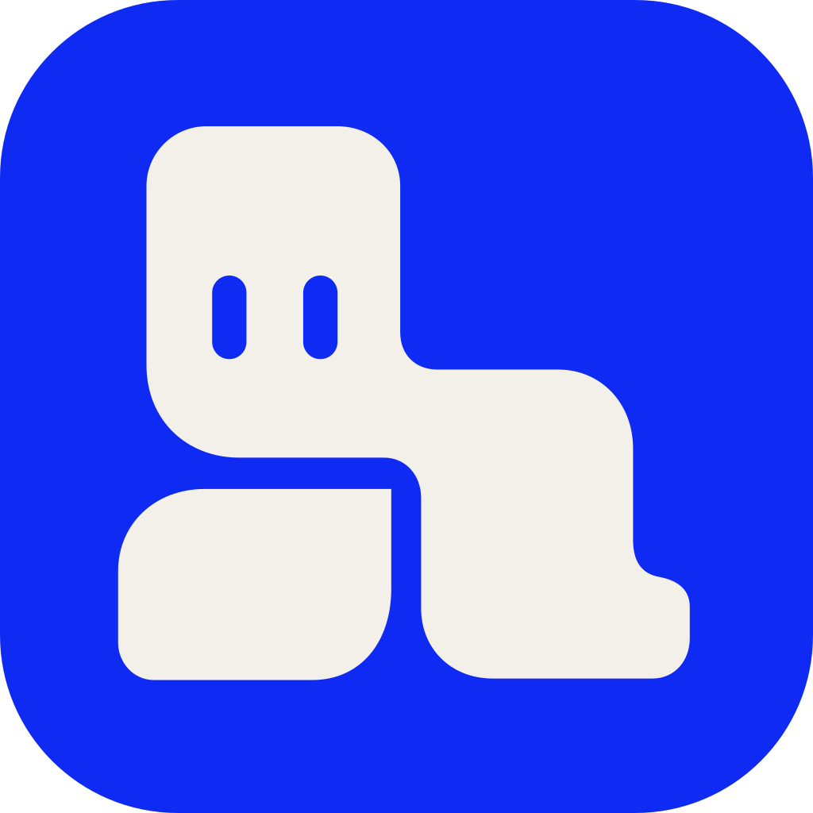</a>
<br /><br />
<b>Every project. Every tool. One window.</b>
<br />
<a href="https://buildwithtabs.com">buildwithtabs.com</a>
</div>
