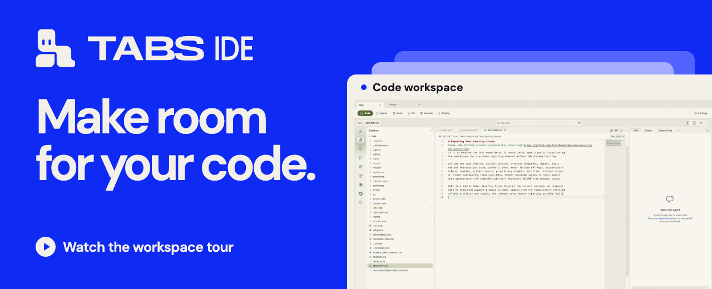
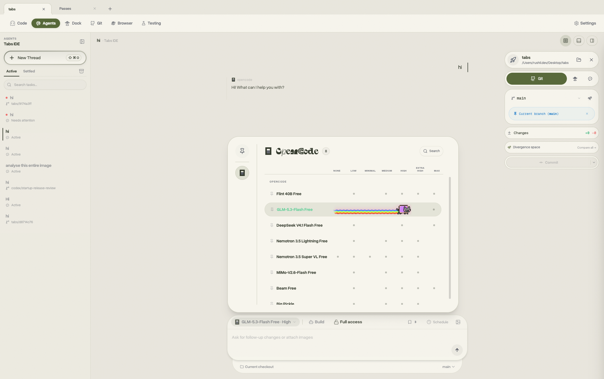

# Tabs IDE

[](#workspace-tour)

Tabs brings your projects, coding agents, and everyday tools into one desktop window. When you switch project tabs, that project’s files, conversations, and toolbar are right there.

**[Download Tabs](https://buildwithtabs.com/downloads)** · [Watch the 44-second tour](#workspace-tour) · [What’s new](CHANGELOG.md) · [Build from source](#build-from-source)

Tabs is in public beta for macOS, Windows, and Linux. The installers include the editor.

> [!NOTE]
> **A note on the macOS beta.** I’m building Tabs independently while I’m a student, so Apple Developer ID signing and notarization are currently unavailable for the macOS beta. If your Mac blocks the first launch, see [Apple’s guidance](https://support.apple.com/102445) or [build from source](#build-from-source).

## Workspace tour

See how to switch projects, open Code, pin Figma to the toolbar, and run a saved terminal command in the same window.

https://github.com/user-attachments/assets/64973868-02fc-4ae7-9edb-01301f0a973a

[Download the tour (MP4)](https://raw.githubusercontent.com/PanicMako/Tabs-ide/0ee96deef6b6d88431b8a6ff788ffd9e0c1d4b26/docs/readme/replay.mp4)

## Start with a project

1. **Install Tabs.** On a Mac, open **Apple menu → About This Mac** to check whether you need the Apple Silicon or Intel download. On Windows, run the `.exe` installer. On Linux, use the `.AppImage` and allow it to run as a program if your system asks.
2. **Open a folder.** Pick a folder you already work in, create a project, or paste a Git repository URL to clone a copy. The guided tour walks through the workspace. If you minimize it, click the mascot to pick up where you left off.
3. **Connect an agent when you’re ready.** Open **Settings → Providers** and follow the setup for the one you use. You can explore your files, browser, and terminal before connecting an agent.
4. **Try a small first task.** Open **Agents** and ask, “What’s in this project, and where should I start?” Open a file in **Code** as you follow along, and use **Git** to review any changes you make.

<details>
<summary>If macOS blocks the app on first launch</summary>

If you trust the download, try opening Tabs once. Then go to **System Settings → Privacy & Security** and choose **Open Anyway**.

</details>

<a name="why-tabs"></a>

## Inside the workspace

<picture>
  <source media="(prefers-color-scheme: dark)" srcset="tabs-app/apps/marketing/public/product/agents-dark.png" />
  
</picture>

- **Projects.** The top row switches between projects. The toolbar below it switches tools for the selected project. A site you pin for one project can stay separate from the tools you use in another.
- **Agents and Code.** Ask an agent to explain a file or help plan a change, then open **Code** to read and edit those files in the built-in Code OSS editor. You can also preview Markdown as you edit it.
- **Browser tabs.** Under **Settings → Workspace → Project Tools → Browser Tabs**, save a URL such as your Figma file or a local preview. Open it again from the project toolbar. Choose a project-shared, isolated, or named browser profile to control which tabs share sign-ins.
- **Terminal tabs.** Under **Project Tools → Terminal Tabs**, save a command you use often, such as starting a preview server or opening a CLI. Give it a name and working directory, then launch it from the toolbar. Use **Toolbar Tools** to arrange your saved tools.
- **Quick Actions.** Press **⌘ + Option + K** on macOS or **Ctrl + Alt + K** on Windows and Linux to open the wheel. Jump to Code, start an agent conversation, or open a temporary browser or terminal.
- **Git.** Review changed files and diffs before committing, then work with branches and pull requests from the same workspace.
- **Appearance and extensions.** Set a theme or wallpaper, preview a different toolbar style, or browse extensions in [Tabs Exchange](https://exchange.buildwithtabs.com).

**Try it out.** From a local checkout, open [`docs/readme/workspace-tour.html`](docs/readme/workspace-tour.html) in your browser. The interactive prototype lets you switch sample projects, add tools, and try Quick Actions.

<a name="supported-providers"></a>

## Use your own agent account

Tabs connects through your provider’s local tool, sign-in, or API key. Your provider’s own plan and usage charges apply. Tabs adds no subscription fee or usage markup.

<details>
<summary>Supported providers and setup</summary>

| Provider           | How to connect                                                                             |
| ------------------ | ------------------------------------------------------------------------------------------ |
| OpenAI Codex       | Install the [Codex CLI](https://developers.openai.com/codex/cli) and run `codex login`.    |
| Anthropic Claude   | Install [Claude Code](https://claude.com/product/claude-code) and run `claude auth login`. |
| Cursor             | Install the [Cursor CLI](https://cursor.com/cli) and run `agent login`.                    |
| GitHub Copilot     | Sign in with GitHub or configure a Copilot token.                                          |
| xAI Grok Build     | Install the [Grok Build CLI](https://x.ai/cli) and run `grok login`.                       |
| OpenCode           | Install [OpenCode](https://opencode.ai) and run `opencode auth login`.                     |
| Google Antigravity | In Providers, enable Antigravity, choose **Install Antigravity**, and sign in with Google. |
| Google Gemini      | Add an API key in Providers or set `GEMINI_API_KEY`.                                       |
| Droid              | Install the Droid CLI or set the path to an existing installation in Providers.            |
| Kilo               | Install the Kilo runtime or configure its path in Providers.                               |
| OpenRouter         | Add an OpenRouter API key in Providers.                                                    |

In **Settings → Providers**, you can also add multiple instances of the same provider and configure custom model IDs. The model picker lets you switch models within a conversation where the provider supports it. Tabs also shows token and cost information when the provider reports it.

</details>

<a name="quick-start"></a>

## Build from source

Clone this repository and open two terminals in its root folder. You’ll need the Node.js version in [`tabs-code-oss/.nvmrc`](tabs-code-oss/.nvmrc), npm, [Bun](https://bun.sh/) 1.3.9 or newer in the 1.3 line, and your OS’s native build tools (Python 3 and a C/C++ toolchain).

**Terminal 1 · Build the embedded editor.** This prepares the copy of Code OSS that Tabs opens when you select **Code**.

```sh
cd tabs-code-oss
npm install
npm run compile
node build/next/index.ts bundle --nls
```

**Terminal 2 · Start Tabs.** After the editor build finishes, run the following from the repository root.

```sh
cd tabs-app
bun install
bun run dev:desktop
```

`bun run dev:desktop` launches the Electron app. Leave it running while you work. If you’re editing Code OSS itself, run `npm run watch` in Terminal 1 after the initial build so editor changes keep compiling. See the [developer guide](tabs-app/README.md) for troubleshooting and contribution checks.

## Privacy and feedback

Tabs does not collect your code, chats, or provider keys. Requests go to the provider you configure. Packaged releases send an anonymous daily activity ping with installation and version metadata. Set `TABS_TELEMETRY_ENABLED=false` before starting Tabs to turn that ping off. [Read the privacy details](tabs-app/docs/privacy.md).

- [Report a bug](https://github.com/PanicMako/Tabs-ide/issues/new?template=bug_report.yml) with your Tabs version, operating system, and steps to reproduce it.
- [Contribute to Tabs](CONTRIBUTING.md) or read the [security reporting policy](SECURITY.md).
- [Browse desktop releases](https://github.com/PanicMako/Tabs-ide/releases) and the [release history](CHANGELOG.md).

## Built on open source

[T3 Code](https://github.com/pingdotgg/t3code) provided the foundation for the agent workspace, [Code OSS](https://github.com/microsoft/vscode) powers the embedded editor, and [Synara](https://trysynara.com) inspired multi-agent workflows. See the [MIT license](LICENSE) and [component notices](LICENSING.md). [View verified build activity on Not a Cent](https://notacent.app/en/app/tabs-ide).
