<div align="center">

<a href="https://buildwithtabs.com">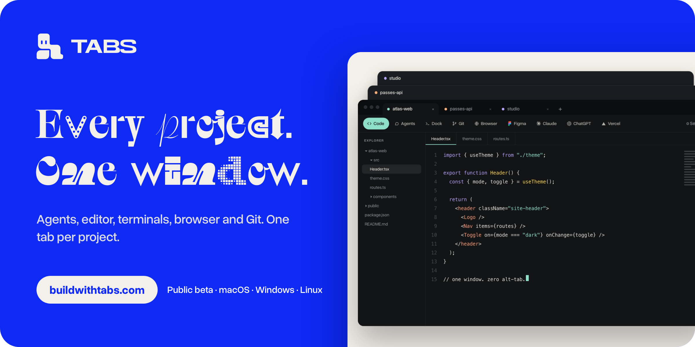</a>

<br />

**[Download](https://buildwithtabs.com/downloads)** &nbsp;·&nbsp; [Watch the film](docs/readme/tabs-launch.mp4) &nbsp;·&nbsp; [Build it yourself](#build-it-yourself) &nbsp;·&nbsp; [What’s new](CHANGELOG.md)

</div>

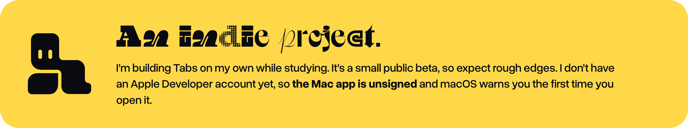

<div align="center">

On a Mac? &nbsp;[Allow the app in two clicks](#if-macos-blocks-the-app) &nbsp;·&nbsp; [Build it yourself](#build-it-yourself)

</div>

## Nine windows. One job.

Editor, terminal, browser, agents, Git, design files. Tabs puts them in one window.

<div align="center">
<a href="docs/readme/tabs-launch.mp4">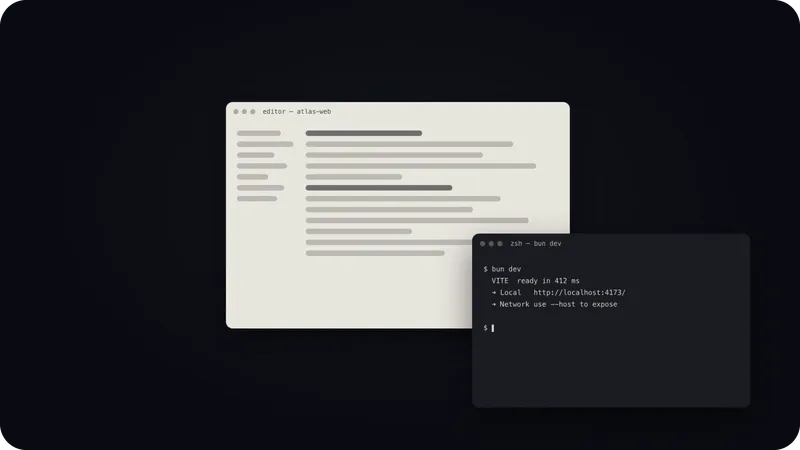</a>
</div>

## One tab per project

Switch projects like browser tabs. Each one keeps its own files, agents, terminals and toolbar.

<div align="center">
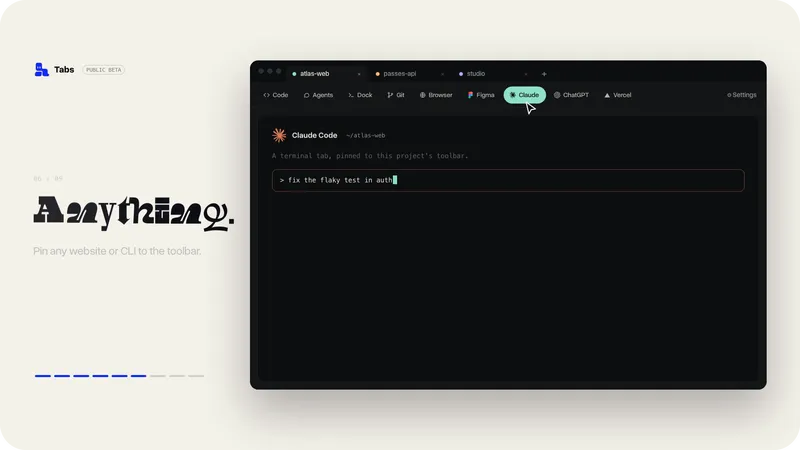
</div>

## What’s inside

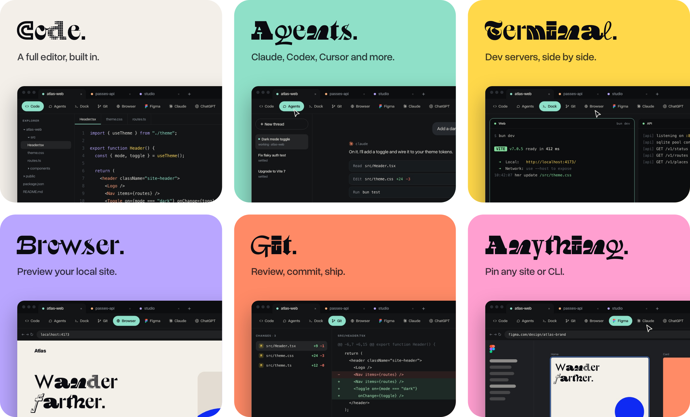

Press **⌘ ⌥ K** (or **Ctrl Alt K**) for Quick Actions: jump to a tool, or open a throwaway browser or terminal.

<details>
<summary>See the real app</summary>

<br />

<picture>
  <source media="(prefers-color-scheme: dark)" srcset="docs/readme/app-dark.png" />
  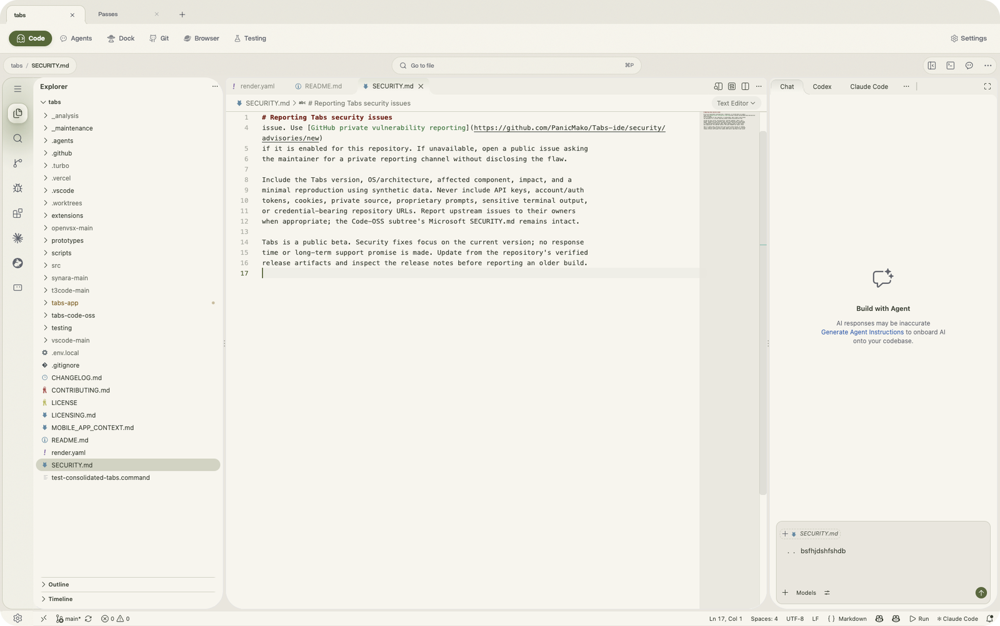
</picture>

</details>

<br />

<a name="get-tabs"></a>

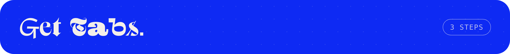

<a href="https://buildwithtabs.com/downloads">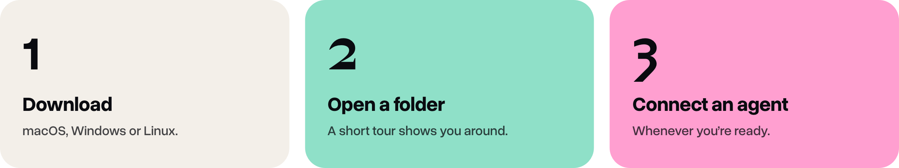</a>

<div align="center">

**[Download Tabs →](https://buildwithtabs.com/downloads)**

</div>

Connect an agent later in **Settings → Providers**.

<a name="if-macos-blocks-the-app"></a>

<details>
<summary>If macOS blocks the app</summary>

<br />

1. Try to open Tabs once and dismiss the warning.
2. Open **System Settings → Privacy & Security** and choose **Open Anyway**.

[Apple’s guide](https://support.apple.com/102445) covers the same steps.

</details>

<details>
<summary>Which download do I need?</summary>

<br />

- **Mac:** open **Apple menu → About This Mac** to see whether you have Apple Silicon or Intel.
- **Windows:** run the `.exe` installer.
- **Linux:** use the `.AppImage` and allow it to run as a program if asked.

</details>

<a name="build-from-source"></a>
<a name="quick-start"></a>

<br />

<a name="build-it-yourself"></a>

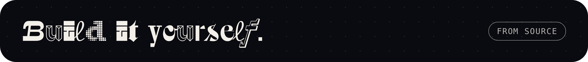

Two folders matter. You compile one, and you run the other.

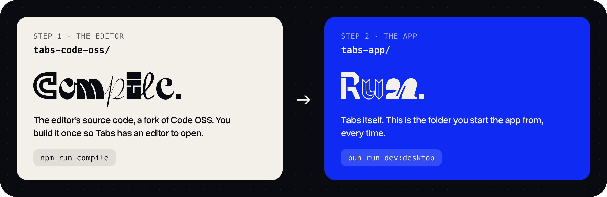

**1 · Get the code**

```sh
git clone https://github.com/PanicMako/Tabs-ide.git
cd Tabs-ide
```

**2 · Compile the editor** (once, and it takes a while)

```sh
cd tabs-code-oss
npm install
npm run compile
node build/next/index.ts bundle --nls
```

**3 · Run Tabs** (every time)

```sh
cd ../tabs-app
bun install
bun run dev:desktop
```

<details>
<summary>What you need installed</summary>

<br />

- [Node.js](https://nodejs.org) and npm, at the version in [`tabs-code-oss/.nvmrc`](tabs-code-oss/.nvmrc)
- [Bun](https://bun.sh) 1.3.9 or newer in the 1.3 line
- Python 3 and a C/C++ toolchain for your OS
- Git

Stuck, or want to work on the code? See the [developer guide](tabs-app/README.md).

</details>

<a name="supported-providers"></a>

<br />

<a name="bring-your-own-agents"></a>

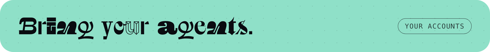

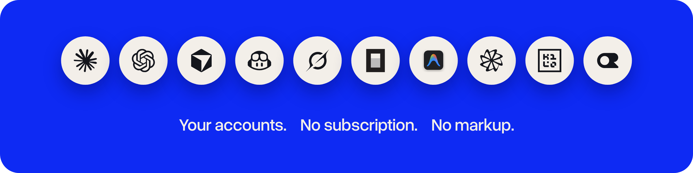

<details>
<summary>Supported agents and how to connect each</summary>

<br />

| Agent              | How to connect                                                                             |
| ------------------ | ------------------------------------------------------------------------------------------ |
| OpenAI Codex       | Install the [Codex CLI](https://developers.openai.com/codex/cli) and run `codex login`.    |
| Anthropic Claude   | Install [Claude Code](https://claude.com/product/claude-code) and run `claude auth login`. |
| Cursor             | Install the [Cursor CLI](https://cursor.com/cli) and run `agent login`.                    |
| GitHub Copilot     | Sign in with GitHub or configure a Copilot token.                                          |
| xAI Grok Build     | Install the [Grok Build CLI](https://x.ai/cli) and run `grok login`.                       |
| OpenCode           | Install [OpenCode](https://opencode.ai) and run `opencode auth login`.                     |
| Google Antigravity | In Providers, enable Antigravity, choose **Install Antigravity**, and sign in with Google. |
| Google Gemini      | Add an API key in Providers or set `GEMINI_API_KEY`.                                       |
| Droid              | Install the Droid CLI or set the path to an existing installation in Providers.            |
| Kilo               | Install the Kilo runtime or configure its path in Providers.                               |
| OpenRouter         | Add an OpenRouter API key in Providers.                                                    |

Your provider’s own plan and usage charges apply.

</details>

<br />

<a name="good-to-know"></a>

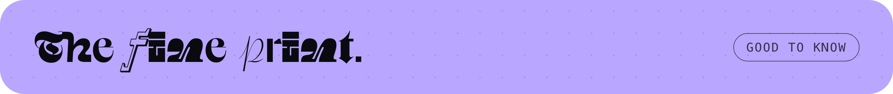

<details>
<summary>Privacy</summary>

<br />

Tabs does not collect your code, chats, or provider keys. Requests go to the provider you configure. Packaged releases send an anonymous daily activity ping with installation and version metadata. Set `TABS_TELEMETRY_ENABLED=false` before starting Tabs to turn it off. [Read the privacy details](tabs-app/docs/privacy.md).

</details>

<details>
<summary>Bugs, contributing and releases</summary>

<br />

- [Report a bug](https://github.com/PanicMako/Tabs-ide/issues/new?template=bug_report.yml)
- [Contribute](CONTRIBUTING.md) or read the [security policy](SECURITY.md)
- [Releases](https://github.com/PanicMako/Tabs-ide/releases) and [release history](CHANGELOG.md)
- Extensions live in [Tabs Exchange](https://exchange.buildwithtabs.com)

</details>

<details>
<summary>Built on open source</summary>

<br />

[T3 Code](https://github.com/pingdotgg/t3code) provided the foundation for the agent workspace, [Code OSS](https://github.com/microsoft/vscode) powers the embedded editor, and [Synara](https://trysynara.com) inspired multi-agent workflows. See the [MIT license](LICENSE) and [component notices](LICENSING.md). [View verified build activity on Not a Cent](https://notacent.app/en/app/tabs-ide).

The film and artwork on this page are generated from code in [`docs/launch-film`](docs/launch-film).

</details>

<div align="center">
<br />
<a href="https://buildwithtabs.com">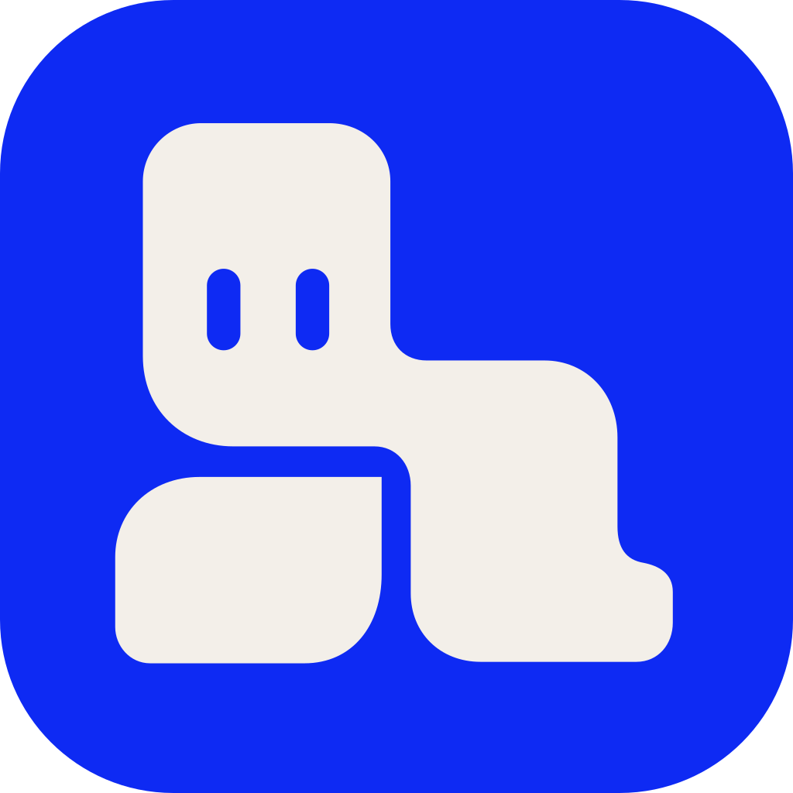</a>
<br /><br />
<b>Every project. Every tool. One window.</b>
<br />
<a href="https://buildwithtabs.com">buildwithtabs.com</a>
</div>
