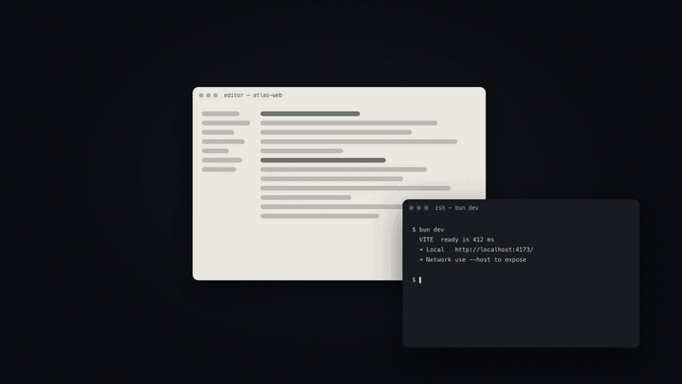
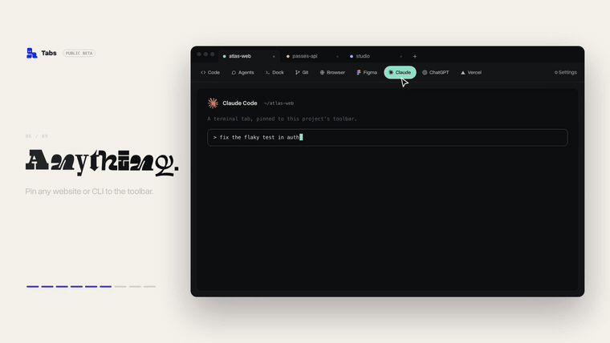

<div align="center">

<a href="https://buildwithtabs.com"></a>

<br />

**[Download Tabs](https://buildwithtabs.com/downloads)** &nbsp;·&nbsp; [Watch the launch film](docs/readme/tabs-launch.mp4) &nbsp;·&nbsp; [What’s new](CHANGELOG.md) &nbsp;·&nbsp; [Build it yourself](#build-it-yourself)

[](https://github.com/PanicMako/Tabs-ide/releases)

[](LICENSE)

</div>

> [!IMPORTANT]
> **Tabs is made by one person.** I’m an indie developer and a student. I built Tabs for my own work, and this is a small public beta, so expect rough edges.
>
> **The macOS build is unsigned.** I don’t have an Apple Developer account yet, so the Mac app isn’t signed or notarized and macOS will warn you the first time you open it. You can [allow it in two clicks](#if-macos-blocks-the-app), or [build Tabs yourself](#build-it-yourself) from this repository.

## Nine windows. One job.

Building one feature usually means an editor, a terminal, a browser preview, an agent chat, a Git client, a design file and a couple of AI tabs, all in separate windows.

Tabs puts them in one window and gives each project its own tab.

<div align="center">
<a href="docs/readme/tabs-launch.mp4"></a>
<br />
<sub>From the launch film. <a href="docs/readme/tabs-launch.mp4">Watch all 41 seconds, with sound.</a></sub>
</div>

## Projects are tabs

The top row is your projects. Switch between them the way you switch browser tabs. Each project keeps its own files, agent conversations, terminals and toolbar, so the Figma file you pinned for one project stays out of the way in another.

<div align="center">

</div>

## What’s in the toolbar

The row under the project tabs is that project’s tools.

| Tool | What you do there |
| --- | --- |
| **Code** | Read and edit files in a full Code OSS editor, the open-source core of VS Code. |
| **Agents** | Chat with Claude, Codex, Cursor and other coding agents in a focused view, using your own accounts. |
| **Dock** | Run terminals side by side, such as a dev server next to an API. |
| **Git** | Review diffs, commit, and work with branches and pull requests. |
| **Browser** | Preview your local site, or compare it at different screen sizes. |
| **Your own tabs** | Pin any website (Figma, ChatGPT, Vercel) or any terminal command (Claude Code, a build script) to the toolbar. |

**Quick Actions.** Press **⌘ + Option + K** on macOS, or **Ctrl + Alt + K** on Windows and Linux, to open the wheel. Jump to a tool, start an agent conversation, or open a temporary browser or terminal for a quick search.

This is the real app:

<picture>
  <source media="(prefers-color-scheme: dark)" srcset="tabs-app/apps/marketing/public/product/agents-dark.png" />
  
</picture>

<details>
<summary>Where to set up your own tabs</summary>

- **Browser tabs.** Under **Settings → Workspace → Project Tools → Browser Tabs**, save a URL such as your Figma file or a local preview. Choose a project-shared, isolated, or named browser profile to control which tabs share sign-ins.
- **Terminal tabs.** Under **Project Tools → Terminal Tabs**, save a command you use often. Give it a name and working directory, then launch it from the toolbar.
- **Toolbar order.** Use **Toolbar Tools** to arrange what you saved.
- **Appearance and extensions.** Set a theme or wallpaper, try a different toolbar style, or browse extensions in [Tabs Exchange](https://exchange.buildwithtabs.com).

You can also try the layout without installing anything: from a local checkout, open [`docs/readme/workspace-tour.html`](docs/readme/workspace-tour.html) in your browser.

</details>

## Get Tabs

1. **Download it** from **[buildwithtabs.com/downloads](https://buildwithtabs.com/downloads)**. The installer includes the editor.
   - **Mac:** open **Apple menu → About This Mac** to see whether you need the Apple Silicon or Intel download.
   - **Windows:** run the `.exe` installer.
   - **Linux:** use the `.AppImage` and allow it to run as a program if your system asks.
2. **Open a folder.** Pick a folder you already work in, create a project, or paste a Git repository URL to clone it. A guided tour walks you through the workspace. If you minimize it, click the mascot to continue.
3. **Connect an agent when you’re ready.** Open **Settings → Providers** and follow the setup for the one you use. The editor, browser and terminal work before you connect anything.
4. **Try a small first task.** Open **Agents** and ask, “What’s in this project, and where should I start?”

<a name="if-macos-blocks-the-app"></a>

<details>
<summary><b>If macOS blocks the app</b></summary>

<br />

macOS shows a warning because the beta isn’t signed with an Apple Developer ID (see the note at the top).

1. Try to open Tabs once and dismiss the warning.
2. Open **System Settings → Privacy & Security**, scroll down, and choose **Open Anyway**.

[Apple’s guide](https://support.apple.com/102445) covers the same steps. If you’d rather not run an unsigned app, [build Tabs yourself](#build-it-yourself).

</details>

<a name="build-from-source"></a>
<a name="quick-start"></a>

## Build it yourself

You can compile and run Tabs from this repository. Two folders matter:


| Folder | What it is | What you do with it |
| --- | --- | --- |
| [`tabs-code-oss/`](tabs-code-oss) | The source code of the editor, a fork of Code OSS. | **Compile it once.** You don’t run anything from here. |
| [`tabs-app/`](tabs-app) | Tabs itself: the window, project tabs, agents, terminals and browser. | **Run the app from here**, every time. |

### Before you start

| You need | Version |
| --- | --- |
| [Node.js](https://nodejs.org) and npm | The version in [`tabs-code-oss/.nvmrc`](tabs-code-oss/.nvmrc) |
| [Bun](https://bun.sh) | 1.3.9 or newer in the 1.3 line |
| Native build tools | Python 3 and a C/C++ toolchain for your OS |
| Git | Any recent version |

### 1 · Get the code

```sh
git clone https://github.com/PanicMako/Tabs-ide.git
cd Tabs-ide
```

### 2 · Compile the editor

This builds the copy of Code OSS that Tabs opens when you select **Code**. The first run takes a while.

```sh
cd tabs-code-oss
npm install
npm run compile
node build/next/index.ts bundle --nls
```

### 3 · Run Tabs

When the editor has finished compiling, go back to the repository root and start the app.

```sh
cd ../tabs-app
bun install
bun run dev:desktop
```

`bun run dev:desktop` opens the Tabs window. Leave that terminal running while you use the app. Next time, you only need this third step.

If the editor doesn’t appear inside Tabs, or you want to work on the code, see the [developer guide](tabs-app/README.md). If you’re changing Code OSS itself, run `npm run watch` in `tabs-code-oss` so your edits keep compiling.

<a name="supported-providers"></a>

## Use your own agent account

Tabs connects through your provider’s local tool, sign-in, or API key. Your provider’s own plan and usage charges apply. Tabs adds no subscription fee or usage markup.

<details>
<summary>Supported providers and setup</summary>

<br />

| Provider           | How to connect                                                                             |
| ------------------ | ------------------------------------------------------------------------------------------ |
| OpenAI Codex       | Install the [Codex CLI](https://developers.openai.com/codex/cli) and run `codex login`.    |
| Anthropic Claude   | Install [Claude Code](https://claude.com/product/claude-code) and run `claude auth login`. |
| Cursor             | Install the [Cursor CLI](https://cursor.com/cli) and run `agent login`.                    |
| GitHub Copilot     | Sign in with GitHub or configure a Copilot token.                                          |
| xAI Grok Build     | Install the [Grok Build CLI](https://x.ai/cli) and run `grok login`.                       |
| OpenCode           | Install [OpenCode](https://opencode.ai) and run `opencode auth login`.                     |
| Google Antigravity | In Providers, enable Antigravity, choose **Install Antigravity**, and sign in with Google. |
| Google Gemini      | Add an API key in Providers or set `GEMINI_API_KEY`.                                       |
| Droid              | Install the Droid CLI or set the path to an existing installation in Providers.            |
| Kilo               | Install the Kilo runtime or configure its path in Providers.                               |
| OpenRouter         | Add an OpenRouter API key in Providers.                                                    |

In **Settings → Providers**, you can also add multiple instances of the same provider and configure custom model IDs. The model picker lets you switch models within a conversation where the provider supports it. Tabs also shows token and cost information when the provider reports it.

</details>

## Privacy and feedback

Tabs does not collect your code, chats, or provider keys. Requests go to the provider you configure. Packaged releases send an anonymous daily activity ping with installation and version metadata. Set `TABS_TELEMETRY_ENABLED=false` before starting Tabs to turn that ping off. [Read the privacy details](tabs-app/docs/privacy.md).

- [Report a bug](https://github.com/PanicMako/Tabs-ide/issues/new?template=bug_report.yml) with your Tabs version, operating system, and steps to reproduce it.
- [Contribute to Tabs](CONTRIBUTING.md) or read the [security reporting policy](SECURITY.md).
- [Browse desktop releases](https://github.com/PanicMako/Tabs-ide/releases) and the [release history](CHANGELOG.md).

## Built on open source

[T3 Code](https://github.com/pingdotgg/t3code) provided the foundation for the agent workspace, [Code OSS](https://github.com/microsoft/vscode) powers the embedded editor, and [Synara](https://trysynara.com) inspired multi-agent workflows. See the [MIT license](LICENSE) and [component notices](LICENSING.md). [View verified build activity on Not a Cent](https://notacent.app/en/app/tabs-ide).

The launch film, cover and diagrams on this page are generated from code in [`docs/launch-film`](docs/launch-film).

<div align="center">
<br />
<a href="https://buildwithtabs.com"></a>
<br /><br />
<b>Every project. Every tool. One window.</b>
<br />
<a href="https://buildwithtabs.com">buildwithtabs.com</a>
</div>
