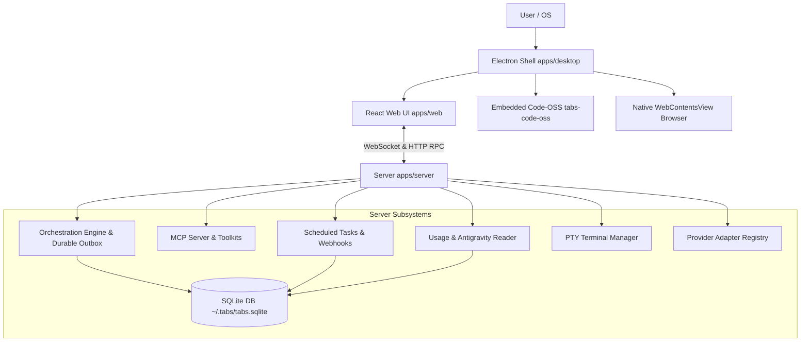

# Tabs IDE: T3 Parity Architecture & Migration Blueprint

**Author**: Antigravity Pair Programmer  
**Target Branch**: `codex/t3-parity-goal-2026-10-06`  
**Base Commit**: `117643e40e33ee3a897bd00571186f9c674c25a7`  
**Reference Upstream**: `pingdotgg/t3code@76d3c96fd5b89cca2c06aeaceaea16100c75084a`

---

## 1. System Architecture Overview

Tabs IDE is a hybrid desktop application comprising:

1. **Desktop Shell (`apps/desktop`)**: Electron 44 host managing native windows, menus, global shortcuts, and embedding the custom Code-OSS editor (`tabs-code-oss`) alongside native `WebContentsView` browser partitions.
2. **Backend Server (`apps/server`)**: Node.js/Bun WebSocket & HTTP server hosting the orchestration runtime, SQLite persistence, AI provider adapters (Claude, Codex, OpenCode, Antigravity, Pi, Generic ACP, etc.), terminal PTY manager, Git manager, and MCP HTTP server.
3. **Frontend Client (`apps/web`)**: React 19 / Vite single-page application communicating via WebSocket and HTTP to `apps/server`. Provides ChatView, Project Workspace, Git surfaces, Testing, Settings, and the new **Agents Companion Panel**.
4. **Contracts Layer (`packages/contracts`)**: Pure Effect/Schema contracts defining RPC protocols, event streams, provider models, and settings.
5. **Shared Runtime (`packages/client-runtime`, `packages/shared`)**: Shared connection supervisor, load balancing, markdown directives, git utilities, and environment models.

---

## 2. Orchestration Runtime Ownership & State Transitions

### 2.1 The Problem with Legacy Orchestration

In Tabs baseline (v1.3.34), orchestration relies on an in-memory command queue with projection pipelines:

- `OrchestrationEngine.ts` processes commands serially.
- Provider turns were locked to a single provider once started.
- Subagents were observed via standard I/O events, but lacked app-owned durable task state, parent-child delegation routing, or scheduled background continuation.
- In-flight turns interrupted by restarts or rate limits could not safely recover without user intervention.

### 2.2 The V2 Orchestration Model

The V2 model introduced in this migration provides:

1. **Durable Effects & Outbox (`EffectOutbox.ts`, `EffectWorker.ts`)**:
   - Commands write intention to an outbox within the same SQLite transaction.
   - Workers process effects asynchronously with exponential backoff and guaranteed idempotency via stable `clientRequestId` and `runId`.
2. **Explicit Run Lifecycle (`RunExecutionService.ts`)**:
   - Every provider interaction belongs to an explicit `Run`: `pending` -> `running` -> `waiting` (for approval/input) -> `completed` / `failed` / `interrupted` / `cancelled`.
   - Distinct from socket connection state: closing the window does not abort the background run.
3. **Capability-Aware Provider Switching (`ProviderSwitchService.ts`, `ContextHandoffService.ts`)**:
   - Replaces provider locking with dynamic context handoffs.
   - Computes token budget, selects historical turns, marks omissions, and injects portable history into the new provider's turn.
4. **App-Owned Delegation (`OrchestratorMcpService.ts`)**:
   - Agents invoke `delegate_task` to spawn child threads with designated models and instructions.
   - Child threads execute as independent server-owned runs.
   - Completion events and approval requests route directly back to the parent run without busy polling.

---

## 3. Data Migration & Persistence Strategy

### 3.1 Migration Philosophy: Safe, Incremental, Non-Destructive

- All legacy database tables (`projection_threads`, `projection_thread_messages`, `projection_thread_activities`, `projection_thread_sessions`) remain intact and queryable.
- New V2 tables and columns are added using idempotent migration steps with `PRAGMA table_info` existence checks.
- When existing databases are opened, a background migration backfills legacy threads into the V2 thread and run tables while preserving:
  - Stable Thread IDs
  - Project associations and workspace roots
  - Original timestamps and message ordering
  - Existing checkpoints and approvals
  - Pinned and settled statuses

### 3.2 Key Database Schema Updates

1. `scheduled_tasks`: Stores cron/interval schedules, webhook URLs, next execution times, and target threads.
2. `webhook_deliveries`: Logs webhook delivery receipts, statuses, and payload hashes.
3. `pull_request_files_viewed`: Persists per-user, per-revision reviewed file checkboxes.
4. `usage_cache`: Caches parsed historical token usages from Antigravity SQLite databases, Cursor, Grok, OpenCode, Claude, and Codex transcripts.
5. `orchestration_v2_effects`: Outbox table for durable background task execution and recovery.

---

## 4. Agents Companion Panel Integration

### 4.1 Coexistence with Top-Level Tools

Tabs provides top-level tools in the main navigation:

- `Agents` (Chat & AI pair programming)
- `Browser` (Full-page browser view)
- `Code` (Embedded Code-OSS IDE)
- `Git` (Repository management, diffs, branches, PRs)
- `Terminal` (Dedicated terminal window)
- `Testing` (Test runner and diagnostics)

The **Agents Companion Panel** does NOT replace these tools. Instead, it embeds a contextual right-hand companion sheet inside the `Agents` view so the user can:

- Inspect file trees and preview documents without leaving the chat.
- Test web applications in a companion browser while instructing the agent.
- Run terminal commands side-by-side with chat.
- Review hunks and linked pull requests directly beside the conversation.

### 4.2 Native Surface Coordination

Because Tabs uses Electron `WebContentsView` for browser rendering and an embedded Code-OSS child window:

- The companion panel uses `rightPanelStore.ts` to manage active tabs (`browser`, `files`, `terminal`, `diff`, `pull-request`).
- When the companion browser tab is active, the desktop bridge reparents or adjusts bounds of the `WebContentsView` to match the companion panel container.
- When switching back to the top-level Browser tool, the same underlying browser session is restored without reloading pages or losing state.

---

## 5. Antigravity Usage Ingestion Pipeline

### 5.1 Protobuf Metadata Extraction

Antigravity stores generation token metadata directly within SQLite tables (`gen_metadata`, `steps`, `trajectory_metadata_blob`) in encoded protobuf formats.

- The `antigravityUsageReader.ts` connects via `node:sqlite` in read-only mode (`DatabaseSync(..., { readOnly: true })`).
- It decodes protobuf varints and messages without executing or parsing raw conversation text.
- Token counts are categorized into: `uncachedInputTokens`, `cachedInputTokens`, `cacheCreationTokens`, `outputTokens`, `reasoningTokens`.
- Deduplication keys ensure rotated files or duplicate database paths across instances do not double-count tokens.

---

## 6. Development Isolation & Rollback Safeguards

1. **Development Directory Isolation**:
   - Dev runs MUST use a dedicated isolated home directory via `TABS_HOME=/Users/rushil.dev/Desktop/tabs/.worktrees/t3-parity-goal-2026-10-06/.tabs-dev`.
   - Never run tests or dev servers against live `~/.tabs` or `~/.t3`.
2. **Process Management**:
   - Maximum 1 running instance of `tabs-dev-root`.
   - Before launch, always verify with `ps aux | grep -iE "tabs-dev-root|dist-electron|apps/server/dist"`.
3. **Rollback Plan**:
   - If any migration fails, SQLite transactions ensure partial writes are rolled back.
   - The task branch `codex/t3-parity-goal-2026-10-06` is completely isolated from `main`.
