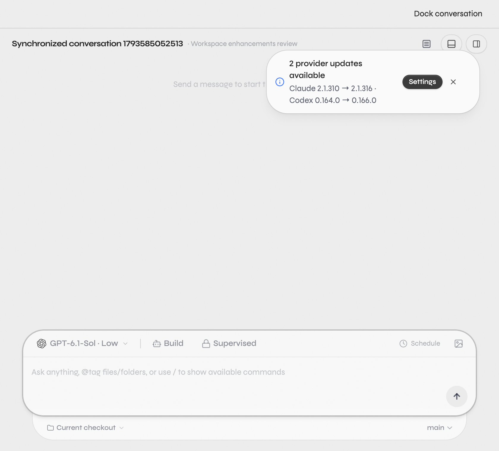
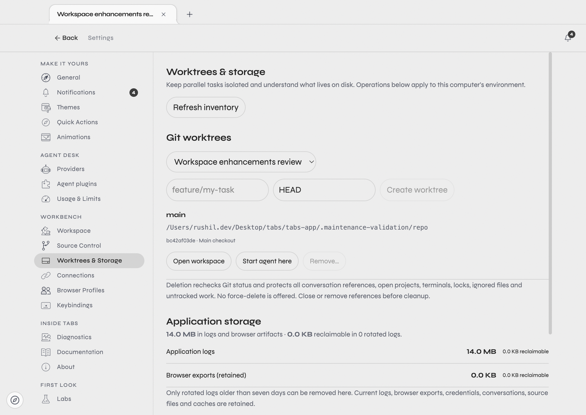

# Workspace enhancements review

Implementation date: 2 November 2026. All changes stay local on `codex/tabs-workspace-enhancements`.

## Git and preservation

- Starting branch: `codex/windows-installer-performance`.
- Starting commit: `00af374ba2d63c7c87e21f2a8d31b97f16bf8722`.
- Initial checkout: clean. No user changes needed moving or stashing.
- Milestone `525c66fbf`: protected worktree/storage RPCs and shared settings foundations.
- Milestone `e75ea9010`: conversation windows, five launchers, settings, native invocation, and safety regressions.
- The final review commit adds this guide, screenshots, repeatable smoke coverage, semantic page headings, keyboard navigation polish, and formatting.
  Its exact hash is in the final chat handoff and `git log -1`.
- No merge, push, release, deployment, dependency upgrade, destructive Git operation, or stash operation was performed.

## What is implemented

### Conversation windows

Open an existing conversation and use **Pop out conversation** in its header, or the launcher action.
A detached window renders the same server thread using the existing authenticated transport,
stream subscriptions, conversation component, composer, approvals and tool surfaces. It runs the
full application bootstrap instead of the diagnostics-only pop-out bootstrap.

Different conversations get independent windows. Opening an already-open conversation focuses
and restores that window. **Dock conversation** focuses the original thread in the main window
and closes the detached view. Closing a detached view sends no task stop or deletion command.
New windows open on the display nearest the pointer. Navigation and IPC retain the existing
trusted-frame boundaries; external pages cannot become privileged pop-out windows.

Implementation: `apps/desktop/src/main.ts`, `preload.ts`, `apps/web/src/routes/__root.tsx`,
`_chat.tsx`, `_chat.$environmentId.$threadId.tsx`, and `components/chat/ChatHeader.tsx`.

Limits: local drafts must become persisted conversations before detaching. Window geometry and
open detached windows are not restored after a full app restart. Closing the main app still uses
its existing shutdown behavior. Real paid-provider streaming and approval dialogs were not
exercised against a live account; they use the unchanged ChatView/provider execution path.



### Worktrees

Open **Settings → Worktrees & Storage** and choose a local project. Create a named branch/worktree
from a base branch or commit, inspect its HEAD/branch/status and conversation references, open it
as a workspace, or start an agent using that existing checkout. The launcher also offers
**Isolated agent**, which uses Tabs' existing lazy worktree provisioning on first message.

Removal uses Git's registered worktrees, rechecks status and ownership under the existing workspace
lease, and never forces removal or deletes the branch. Main checkouts, locks, modified/untracked
or ignored files, projects, conversation references, live provider sessions and terminals prevent
removal. User Git settings cannot hide untracked files from the removal check. Missing registered
checkouts can have their stale Git record removed without deleting a branch or traversing a directory.

Implementation: `apps/server/src/workspaceMaintenance.ts`, `workspaceCompatibilityHandlers.ts`,
`git/Layers/GitCore.ts`, and `apps/web/src/components/settings/WorkspaceMaintenanceSettings.tsx`.
Creation and actual removal reuse the existing Git services; they are not a second Git lifecycle engine.

Limits: this settings panel manages the primary local environment. Settled conversation references
remain protected, deliberately, until their references are removed. Windows removal requires Git
2.54 or later; macOS was exercised directly, while Windows/Linux behavior was not graphically tested.
Worktree directory sizes are not included in the storage byte totals.

### Storage

The same settings page reports measured log/browser-artifact bytes, eligible rotated logs, file
sizes and dates, and reclaimable bytes. Manual cleanup removes only selected inventory identities
for rotated `.log.N` / `.ndjson.N` files older than seven days. Refresh, operation status, explicit
confirmation, and per-operation errors are connected to real RPCs and filesystem operations.

Candidate IDs bind path, inode, size and modification time. Cleanup rescans eligibility and
revalidates identity and canonical paths before unlinking. It rejects symlink roots/entries,
hardlinks, changed candidates and arbitrary caller paths. Scans are bounded and report skipped
or inaccessible locations. Provider credentials, current logs, conversations and project files
are outside this manual deletion policy.

Automatic rotated-log retention can be set to manual-only, 7, 14, 30 or 90 days. It uses the existing
hourly cleanup service and server settings. Existing independently configured cleanup policies
remain unchanged.

Limits: this is a bounded application-storage inventory, not a whole-disk scanner. Browser exports
are counted but retained by manual cleanup because conversations can reference them. Arbitrary
caches, attachments and temporary agent files were not labeled disposable without a proven ownership
and lifetime contract. Existing worktree retention infrastructure remains available; no new
unattended deletion policy is enabled.



### Quick Actions

Use the bottom-left compass, **Tools → Quick Actions**, or **Cmd+Option+K / Ctrl+Alt+K**. The shortcut
is editable through **Settings → Keybindings → Quick Actions: Toggle**. The original
Cmd+Shift+Space default conflicts with Siri on newer macOS versions. Startup migrates that
unchanged default to the new binding while preserving custom rules and occupied shortcuts. Native menu accelerators
also work while embedded tools have focus. Conditional shortcut rules stay renderer-scoped because
native menus cannot evaluate renderer focus conditions.

**Settings → Quick Actions** presents every design, an interactive preview, and **Use this design**.
Preview actions execute in the actual workspace. Selection, hidden actions, ordering and the
optional Alt+right-click gesture persist through the existing unified client settings. Customize
remains reachable even if hidden in a stale configuration. Alt+right-click applies to workspace
chrome, leaving ordinary editor text selection and double-clicks alone.

All variants share the action registry and executor:

| Design      | Interaction                                                |
| ----------- | ---------------------------------------------------------- |
| Halo Fade   | Circular icon ring with an action-colored fading highlight |
| Glass Dial  | Labelled glass buttons around the center hub               |
| Pie Sectors | Rounded radial sectors with action-colored gradients       |

The launcher floats directly over the blurred workspace without a rectangular panel.
Arrow keys rotate the selection; Enter runs it. Secondary actions live under one More
item, with up/down navigation. Each action appears once; there are no pages.
Legacy layout preferences open Halo Fade. The center is a label; typing opens search and URL entry.
Hover or focus a parent action to reveal its configurable sub-actions. Edit names, destinations,
and action targets in Quick Actions settings; drag to reorder or use accessible arrow buttons.
Click outside or press Escape to dismiss with a short fade (reduced motion is respected).

Available actions: new workspace tab, new local conversation, isolated agent task, scratch browser, temporary terminal,
web search/URL, pop out conversation, return to code, source control, worktrees/storage, provider
usage/limits, and customization. Context-dependent actions are disabled with an explanation.
Usage opens the existing connected-provider page; no usage values or account data are fabricated.
Search/URL creates a separate browser tool instead of replacing the current browser page. Scratch
and search tools use existing isolated browser partitions and workspace tool settings.

The browser tools are durable workspace tools with isolated cookies, not automatically-expiring or
incognito windows. Manage/remove them through existing workspace tool settings. No new browser
engine or unsupported provider API was introduced.

Focus is trapped in the launcher, Escape restores prior focus, keyboard navigation is available,
positioning clamps to the viewport, native editor/browser views suspend while the overlay is open,
and reduced-motion settings are respected. The design uses Tabs' existing fonts, theme tokens,
icons and control system. Both light and dark renderings were inspected. The design skill's app-screen probes were run
inside Electron at 1440, 900 and 840px; the existing sidebar's 10px group labels were left unchanged.

Implementation: `apps/web/src/components/quick-actions/`, `WorkspaceShell.tsx`,
`settings/QuickActionsSettings.tsx`, shared settings/keybindings contracts, `nativeSurfaceOverlay.ts`,
and the existing Electron menu/IPC code.

## T3 Code investigation

The read-only reference is `t3code-main/` at the repository root. Inspected:

- `apps/server/src/vcs/worktreeRemoval.ts`: explicit untracked-file policy, branch-retaining Git
  removal, Windows junction safety, and refusing uncertain/locked state.
- `apps/server/src/worktreesDirectory.ts`: canonical managed paths, root rejection, and separate
  handling for existing versus recreated worktrees.
- `apps/server/src/storageCleanup.ts`: bounded application-owned cleanup, active resource checks,
  canonical paths, retained conversations and lease-guarded removal.
- `apps/server/src/orchestration-v2/ResourceCleanupService.ts`: resource ownership by thread rather
  than arbitrary filesystem paths.
- `apps/web/src/worktreeCleanup.ts`: shared checkout references and path normalization before removal.
- `apps/web/src/components/settings/WorktreesSettings.tsx`: project/global configuration and reusable
  settings operations.
- `LICENSE`: MIT, copyright T3 Tools Inc. 2026. This implementation adapts the patterns and reuses
  existing Tabs services; it does not import from the reference or copy substantial source blocks.

## Verification

Commands were run from `tabs-app`, except package-specific commands where noted.

| Command/check                                                                          | Outcome                                                                                                  |
| -------------------------------------------------------------------------------------- | -------------------------------------------------------------------------------------------------------- |
| `vp check`                                                                             | Passed after formatting; existing lint warnings remain                                                   |
| `vp run typecheck`                                                                     | All 16 package tasks passed; two existing marketing icon deprecation hints                               |
| `bun run test`                                                                         | All 18 tasks passed: server 7,629 passed / 35 skipped; web 1,813 passed; desktop 712 passed              |
| `vp test --run` with the new action, maintenance and keybinding test files             | 18 passed                                                                                                |
| contracts: `bun run test src/keybindings.test.ts`                                      | 8 passed; literal Space survives RPC encoding/decoding                                                   |
| server: `bun run test src/workspaceMaintenance.test.ts src/git/Layers/GitCore.test.ts` | 71 passed, including stale records, file identity, links, hidden untracked files and Windows safety gate |
| web: `bun run test src/components/quick-actions/actions.test.ts`                       | 3 passed                                                                                                 |
| web: `bun run test:browser src/components/quick-actions/QuickActions.browser.tsx`      | 12 passed; all variants, execution errors, disabled actions and keyboard behavior                        |
| combined launcher + ChatHeader browser run                                             | Both feature suites passed (13 tests); details below for an extra existing overlay suite                 |
| `node scripts/workspace-enhancements-smoke.mjs`                                        | Passed against real Electron, using isolated backend and renderer profiles                               |
| `bun run build:desktop`                                                                | Passed all 4 tasks; existing EMPTY_IMPORT_META bundler warnings                                          |

The Electron smoke verifies two windows, duplicate-window focus, synchronized thread metadata,
thread retention after window close, docking, all previews, reload persistence, default and custom
shortcuts, Alt+right-click boundary positioning, dirty-worktree rejection, clean removal with branch
retention, and exact deletion of a generated aged-log fixture. No live inference or user-owned
cleanup candidate is needed. Scratch-browser creation, URL/search tool creation and usage-page
navigation were additionally exercised through the launcher.

An extra run including `OverlayRegressions.browser.tsx` had two existing radius assertions fail:
connected Labs tabs expect 16px but render 36px, and the onboarding preview expects 16px but renders
12px. The relevant CSS, WorkbenchPreview, and those tests match the starting commit byte for byte.
Their unrelated styles were preserved. The overlay suspension cases in that run passed. This is
separate from the passing default workspace test suite and new launcher browser tests.

Live provider streaming/approvals, screen-reader speech, physical multi-monitor/Windows/Linux UI,
and automatic retention over elapsed hours remain manual verification items. The production
build does not package or publish an installer.

## Manual review

1. Switch to the branch and launch the real desktop app:

   ```sh
   cd /Users/rushil.dev/Desktop/tabs
   git switch codex/tabs-workspace-enhancements
   cd tabs-app
   bun run dev:desktop
   ```

   Check no other development instance is running before launching another.

2. Open a local Git project. In Settings → Worktrees & Storage, enter a fresh branch name, keep
   HEAD or choose another base, and create a checkout. Use Open workspace to switch to it, or
   Start agent here to create a draft associated with that path. Run a real task if desired.

3. Refresh the inventory. Modify a file in a disposable checkout and observe that removal is
   blocked. Clean/commit the work yourself before considering removal. Referenced projects,
   conversations and terminals also protect the checkout. Clean removal keeps the branch.

4. Review storage categories and candidate dates/sizes. If aged rotated logs exist, use Clean
   eligible logs and review the custom confirmation. Choose retention only if you want automation.
   An empty candidate list is a real result, not a disabled implementation.

5. Open a persisted agent conversation, click Pop out conversation, and interact from that window.
   Open a different conversation in another window. Close a pop-out, reopen it, and use Dock
   conversation. For live-provider review, observe streaming, tools and any approvals in that same
   thread while navigating the main workspace elsewhere.

6. Open Quick Actions with the compass or shortcut. Try all three radial styles,
   action-colored selection, browser sub-actions, typing to search, and More options.

7. In Settings → Quick Actions, preview each design, select one, reorder actions, hide a seldom-used
   action and optionally enable Alt+right-click in chrome. Change the shortcut in Keybindings.
   Reload the window to verify persistence. Escape should return to your previous focus.

8. Try Isolated agent, Scratch browser, a typed documentation URL, Return to code, Source control,
   Worktrees & storage and Usage & limits. The browser actions create separate workspace tools;
   remove those tools in Workspace settings when finished.

### Repeat the isolated Electron smoke

Stop any existing development instance first. In terminal A:

```sh
cd /Users/rushil.dev/Desktop/tabs/tabs-app
TABS_HOME="$PWD/.maintenance-validation/app-home" \
TABS_DESKTOP_USER_DATA_DIR="$PWD/.maintenance-validation/electron-profile" \
bun run dev:desktop
```

In terminal B, after the app is ready:

```sh
cd /Users/rushil.dev/Desktop/tabs/tabs-app
node scripts/workspace-enhancements-smoke.mjs
```

The script refuses a backend outside that test home. It uses local throwaway repositories and
requires no model turn. Use Node for the Playwright CDP connection. Captures are written beside
this guide; runtime files/logs stay in the ignored `.maintenance-validation/` directory.

### Native Quick Actions shortcut regression

The desktop shell forwards the configured Quick Actions chord from attached native Code-OSS and
browser views to their owning Tabs window. It consumes that chord before the embedded tool or
native menu can handle it twice. Other keys remain with the embedded view. Matching is shared
with the web app, including physical key fallback for macOS Option dead keys and live rebinding.

Verified with native macOS keyboard input using Command-Option-K in the Code-OSS editor,
Code-OSS integrated zsh terminal, embedded browser (including its offline error page), and Dock
terminal input. Escape returned focus to the integrated terminal. No terminal commands or model
requests were sent. CDP keyboard injection bypasses Electron's native before-input-event hook;
use native keyboard input when repeating these checks.

Validation: desktop build, repository check, all 16 typecheck tasks, and all 18 test tasks passed.
The native forwarding tests cover attached-view ownership, root/unattached exclusions, exact
modifiers, Option/dead keys, repeats/composition, dynamic rebinding, and listener disposal.

### Quick Actions blurred backdrop

Quick Actions now dims and blurs the workspace while keeping embedded Code-OSS and browser
content visible behind it. Before suspending an attached native view, the shared overlay hook
captures and decodes its current viewport into an inert, accessibility-hidden image in the host.
That image remains until the live native view reattaches on dismissal. Captures stay in memory;
no screenshot artifact is saved. A generation check discards captures after close or unmount.
This is a still image while the overlay is open, since CSS cannot blur a separate native view.

Visually verified over the Code-OSS editor and the embedded Google page on macOS. The browser
regression verifies capture-before-hide ordering, keeping pixels through delayed reattachment,
and discarding captures after rapid dismissal. Desktop tests cover missing/closed browser views
and the in-memory viewport capture path.

### Settings consistency and navigation

Quick Actions and Worktrees & Storage use the same SettingsSectionHeader, SettingsSection, form
controls, typography, and theme tokens as the established settings pages. Launcher choices sit
beside the interactive preview on desktop and stack on smaller screens. Worktree creation has
labelled branch fields, compact actions, and a disclosure for protection details. The conversation
pop-out title strip is 32px tall with a compact Dock conversation control.

Settings destinations are now router-owned. Desktop hash parameters override stale outer URL
parameters, and section changes remain reactive when navigating within settings. Manually repeated
Quick Actions → Usage & Limits → Worktrees & Storage → Usage & Limits → Quick Actions with a
conflicting outer section parameter to verify the selected page follows the active route.

### Worktrees & Storage subsection redesign

The page heading and Quick Actions are unchanged. The worktree section now has a repository
selector, a filterable checkout list, compact per-checkout actions, and an on-demand creation form.
Paths, revisions, protection reasons, and inspection errors remain available in expandable details.
Storage has a three-value summary, category rows, an eligible-log review disclosure, and grouped
cleanup and retention controls. Storage results render independently of the Git inspection.

Subsection headers and panel corners use the existing SettingsSection and SettingsRow components.
Repository and retention selectors use Tabs' themed Select popups, with no native dropdown menus.
Browser checks cover filtering, protected removal controls, creation, custom retention selection,
zero storage, and a 390px viewport. Desktop and mobile fixture captures were visually reviewed,
and the custom repository popup was verified in the running Electron app.

### Temporary workspace tools

Scratch browser, web search, and temporary terminal tabs have a close button in both
workspace toolbar styles. Keep opens an app-styled naming dialog and saves the tool to
the workspace. Closing a temporary terminal ends its sessions; closing a temporary
browser releases its native session. Kept tools retain their configuration when closed
and can be reopened from Workspace settings.

### Prototype radial geometry and clipboard

Sub-actions and More use the prototype's adjacent fan: Halo nodes at 112 px with chips at
206 px and 30-degree spacing; Dial nodes at 108 px with chips at 204 px (24/28 degrees);
Pie nodes at 94 px with rounded outer sectors from 134 to 198 px. The action-colored
radial fade follows the active node. Each fan stays beside its parent.

Search has Google and DuckDuckGo sub-actions. Search shortcut URLs can contain `{query}`;
choosing an engine asks for text, then substitutes the encoded query. Temporary browser
shortcuts open destinations directly in an isolated browser tab.

Temporary clipboard is a local scratch pad. Its draft lasts for the window session;
explicitly saved snippets remain on this device until removed. It never reads the system
clipboard automatically. Copy writes only the text the user chooses.
